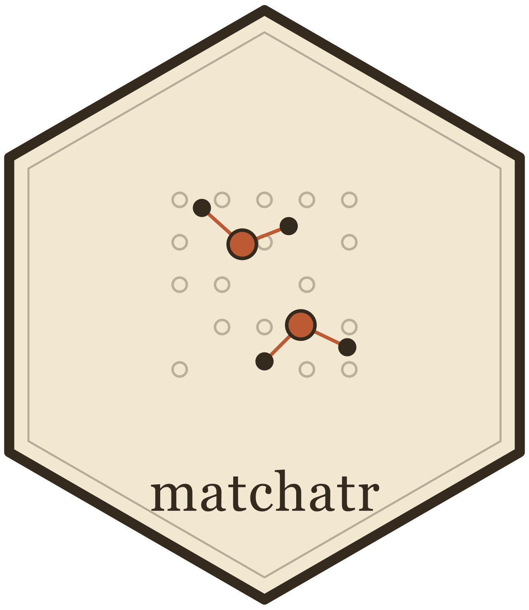

<!-- README.md is generated from README.Rmd. Please edit that file -->

# matchatr 

<!-- badges: start -->

[](https://github.com/etverse/matchatr/actions/workflows/R-CMD-check.yaml)
[](https://app.codecov.io/gh/etverse/matchatr)
[](https://lifecycle.r-lib.org/articles/stages.html#experimental)
[](https://opensource.org/license/mit)
<!-- badges: end -->

**matchatr** provides causal inference for **(matched) case-control,
nested case-control (NCC), and case-cohort** study designs. It pairs
design-faithful classical estimators with marginal causal effects, and
integrates with the [etverse](https://github.com/etverse) ecosystem —
delegating estimation to [`causatr`](https://github.com/etverse/causatr)
(g-computation / IPW / AIPW with sandwich and bootstrap variance) and
[`survatr`](https://github.com/etverse/survatr) (causal survival on
person-period data).

matchatr runs the classical estimator each design supports, and marginal
causal effects for case-control and case-cohort samples. For
**unmatched** case-control data it fits logistic, Mantel-Haenszel and
polytomous odds ratios (with `test_homogeneity()` for the polytomous
case). For **matched** data it fits conditional logistic and McNemar
odds ratios, with stratum-specific effects. For **nested case-control**
data it reports the risk-set hazard ratio, draws samples with
`sample_ncc()`, and fits Samuelsen inverse-probability-weighted Cox,
accelerated failure time and additive-hazards models with absolute and
excess risk; counter-matched samples use a weighted Cox model. For
**case-cohort** data it fits the Prentice, Self-Prentice, Lin-Ying and
Borgan hazard ratios with absolute risk, and marginal survival contrasts
by g-computation (`surv_gcomp`). The `ccw_gformula`, `ccw_ipw`,
`ccw_aipw` and `ccw_tmle` estimators report a marginal risk difference,
risk ratio or marginal odds ratio from an unmatched or matched
case-control sample with a known or estimated prevalence q₀.
`two_phase()` declares a two-phase design but has no estimator yet. See
the [articles](https://etverse.github.io/matchatr/) for worked examples.

## What it does

Two orthogonal axes: a **`design`** object encodes the sampling
structure (strata, matching ratio, time scale, prevalence, inclusion
weights); an **`estimator`** chooses the analysis.

| Design | Classical estimand | Causal (marginal) estimand |
|----|----|----|
| Unmatched case-control | conditional OR, Mantel-Haenszel | RD / RR / marginal OR (case-control weighting) |
| Matched case-control | conditional OR (conditional logistic) | RD / RR via standardization |
| Nested case-control | risk-set HR; Samuelsen IPW Cox | none yet |
| Case-cohort | Prentice / Self-Prentice / Borgan HR | absolute risk, RD(t), RMST |

Marginal causal effects use **case-control weighting** (the Rose & van
der Laan g-formula / IPW / AIPW / TMLE family) and **design-based
inclusion weighting** (Samuelsen, Borgan): the weights are passed as
observation weights into the etverse engines, so they compose directly
with existing estimators.

## Installation

You can install the development version of matchatr from
[GitHub](https://github.com/etverse/matchatr) with:

``` r
# install.packages("pak")
pak::pak("etverse/matchatr")
```

## Example

``` r
library(matchatr)

# Matched case-control -> conditional odds ratio (infert: a matched study of
# spontaneous/induced abortion and infertility, matched on age and parity).
fit <- matcha(
  infert,
  outcome = "case", exposure = "spontaneous",
  design = matched_cc(strata = "stratum"),
  confounders = ~ induced, estimator = "clogit"
)

contrast(fit, type = "or")
#> <matchatr_result>
#>  Estimator:  clogit  (engine: clogit)
#>  Estimand:   conditional OR
#>  Contrast:   Odds ratio
#>  CI method:  model
#>  N:          248
#> 
#> Contrasts:
#>     comparison estimate     se ci_lower ci_upper
#>         <char>    <num>  <num>    <num>    <num>
#> 1: spontaneous 7.285423 2.5677 3.651357 14.53635
```

The marginal causal contrasts (case-control weighting) use the same
two-step API once a source-population prevalence q0 is supplied:

``` r
fit <- matcha(
  data,
  outcome = "case", exposure = "x",
  design = unmatched_cc(prevalence = 0.02),   # source-population prevalence q0
  confounders = ~ age + smoke, estimator = "ccw_gformula"
)
contrast(fit, type = "difference", ci_method = "sandwich")
```

## Roadmap

Planned work is grouped in [ROADMAP.md](ROADMAP.md) and tracked as
[GitHub issues](https://github.com/etverse/matchatr/issues).

## Part of the etverse

matchatr is one package in the [etverse](https://github.com/etverse)
family for causal inference and methodological triangulation, alongside
`causatr` (causal effect estimation) and `survatr` (causal survival
analysis).
